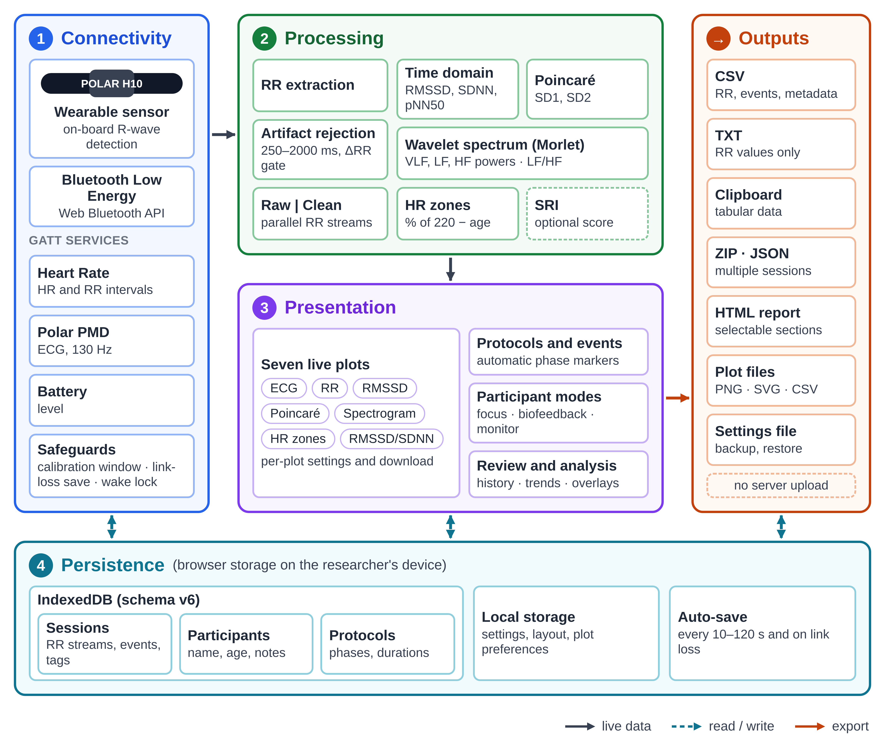
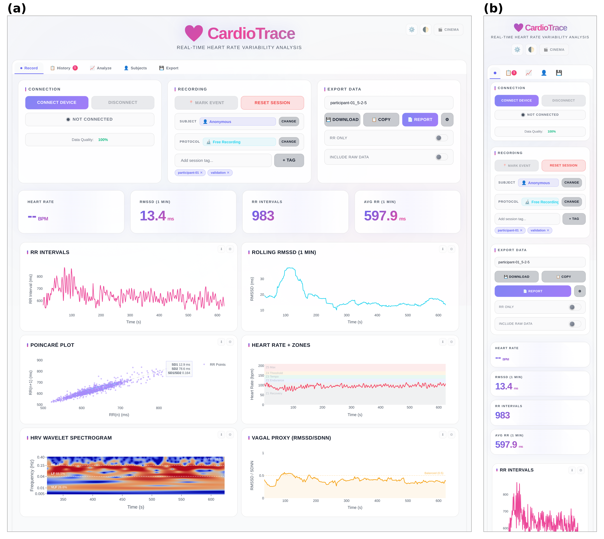
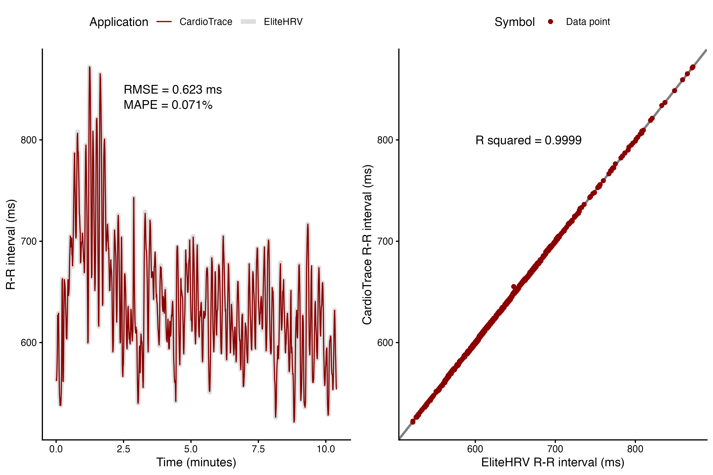

:::{custom-style="MDPI_1.1_article_type"}
Article
:::

:::{custom-style="MDPI_1.2_title"}
CardioTrace: an open-source browser-based platform for real-time RR interval acquisition and event annotation in public health and environmental heart rate variability research
:::

:::{custom-style="MDPI_1.3_authornames"}
Matías Castillo-Aguilar^1,2^, Diego Mabe-Castro^1^, Ginés Viscor^3^, Cristian Núñez-Espinosa^1,2^\*
:::

::: {custom-style="MDPI_1.6_affiliation"}
^1^ Centro Asistencial Docente y de Investigación (CADI-UMAG), Punta Arenas, Chile.

^2^ Escuela de Medicina, Universidad de Magallanes (UMAG), Punta Arenas, Chile

^3^ Physiology Section, Department of Cell Biology, Physiology and
Immunology, Faculty of Biology, Universitat de Barcelona, Barcelona, Spain.

**\*** Correspondence: [cristian.nunez\@umag.cl](mailto:cristian.nunez@umag.cl). Address: Avenida Bulnes 01855, Box 113-D. Phone: +56 61 2201411.
:::

::: {custom-style="MDPI_1.7_abstract"}
**Abstract**

Wearable sensors provide accessible, high-resolution RR-interval data for heart rate variability (HRV) research, yet research-grade acquisition remains limited by proprietary applications, restricted raw-data access, limited event annotation, and weak integration with reproducible analysis workflows. We present CardioTrace, an open-source, browser-based application for real-time acquisition, visualization, annotation, and export of RR intervals from the Polar H10 chest strap via Bluetooth Low Energy. It runs without installation, keeps data on the researcher's device, stores raw and artifact-filtered streams in parallel, and auto-saves sessions, including when the Bluetooth link is lost. Researchers can run timed protocols whose phase transitions are time-stamped automatically, add manual event markers, assign recordings to participant profiles, follow seven live plots, and export CSV, TXT, ZIP, JSON, plot images, or a configurable report. We verified the software at three levels. Two simultaneously worn straps, one paired to EliteHRV, yielded near-identical RR series (R^2^ = 0.9999; RMSE = 0.62 ms). Time-domain and Poincaré indices matched NeuroKit2 within 0.1%. Wavelet-based LF/HF estimates showed a positive bias of 1–8% on synthetic signals. Thirty-nine automated tests passed. CardioTrace standardizes the acquisition layer preceding HRV analysis in public health, occupational, environmental, and field-based studies.
:::

::: {custom-style="MDPI_1.8_keywords"}
**Keywords**: heart rate variability; digital epidemiology; wearable devices; public health monitoring; occupational health; real-time acquisition; event annotation; open-source software.
:::



::: {custom-style="MDPI_2.1_heading1"}
Introduction
:::

::: {custom-style="MDPI_3.1_text"}
Wearable devices capable of streaming high-resolution RR intervals (RRi) are increasingly used in public health monitoring, environmental stress assessments, occupational health, and human performance studies [@castillo2025enhancing; @castillo2025immune; @castillo2026immune]. The scientific value of the resulting data, however, depends on what happens at the acquisition stage: whether the intervals were captured without loss, whether experimental phases and exposures were aligned with the signal, and whether the raw and processed series were preserved and exported transparently. Current reporting recommendations for HRV research stress exactly these aspects, namely documenting the recording conditions, the handling of artifacts, and the timing of events [@quigley2024publication; @laborde2017heart]. In many workflows, however, event timing is still recorded manually or reconstructed retrospectively, which introduces uncertainty that no downstream analysis can remove.

Existing tools address parts of this chain (Table 1). Analysis software and libraries, such as Kubios HRV [@tarvainen2014kubios], NeuroKit2 [@makowski2021neurokit2], and PhysioZoo [@behar2018physiozoo], provide robust post-processing but operate on externally acquired and pre-segmented data. Smartphone applications such as HRV Logger [@altini_hrvlogger] and Elite HRV [@elitehrv] record RR intervals from Bluetooth Low Energy (BLE) sensors and offer varying degrees of feature computation and export, but they are proprietary applications whose processing and annotation behavior cannot be inspected or adapted. Open-source acquisition tools exist, for example OpenHRV [@brammer_openhrv], but they are desktop applications aimed at HRV biofeedback training rather than at structured experimental protocols. To our knowledge, based on the public documentation of these tools, none combines open-source code, installation-free deployment, protocol-driven event marking, and local storage of multiple sessions organized by participant in a single environment.
:::

::: {custom-style="MDPI_4.1_table_caption"}
**Table 1**. Representative tools for RR-interval acquisition and HRV analysis, and the gap addressed by CardioTrace. Entries summarize public documentation reviewed in October 2026.
:::

| Category | Examples | Main role | Limitation for protocol-based acquisition |
|-------------------|-------------------|----------------------|------------------------------------|
| Analysis software and libraries | Kubios HRV [@tarvainen2014kubios]; NeuroKit2 [@makowski2021neurokit2]; PhysioZoo [@behar2018physiozoo] | Post-hoc artifact correction and time-, frequency-, and non-linear analysis | Require externally acquired, pre-segmented RR data |
| Smartphone acquisition apps | HRV Logger [@altini_hrvlogger]; Elite HRV [@elitehrv] | Recording from BLE sensors, feature computation, export | Proprietary applications; automatic protocol-driven event marking and participant-level organization are not described in the public documentation |
| Open-source desktop tools | OpenHRV [@brammer_openhrv] | Real-time HRV biofeedback with ECG chest straps | Aimed at biofeedback training; requires a local Python installation |
| **CardioTrace** | This work | Acquisition, protocol-driven annotation, live analytics, local persistence, review, and export | Validated with the Polar H10 only; requires a Web Bluetooth-capable browser |

::: {custom-style="MDPI_3.1_text"}
The gap is therefore not in analysis methods but in a transparent, reproducible acquisition layer. We derived six design requirements for such a layer: (R1) installation-free deployment that keeps participant data on the researcher's device; (R2) real-time acquisition with raw and artifact-filtered streams stored in parallel; (R3) structured, time-stamped events, either defined by a protocol or entered manually; (R4) fault tolerance against Bluetooth loss and browser interruptions; (R5) open, inspectable processing with numerical results that agree with established tools; and (R6) export in formats usable by downstream analysis software. CardioTrace is an open-source, browser-based application designed around these requirements for the Polar H10 chest strap. Because it supports continuous physiological monitoring with wearable sensors in medical, occupational, and environmental research settings, we consider it within the scope of *Technologies*.

This article describes the architecture and functionality of the software, verifies it at three levels (data integrity against a widely used application, numerical agreement of the computed indices with NeuroKit2, and automated functional tests with a simulated sensor), and discusses its limitations. The novelty of CardioTrace does not lie in replacing established HRV analysis platforms but in standardizing the acquisition layer that precedes them.
:::

::: {custom-style="MDPI_2.1_heading1"}
Materials and Methods
:::

::: {custom-style="MDPI_2.2_heading2"}
Software architecture
:::

::: {custom-style="MDPI_3.1_text"}
CardioTrace follows a single-tier, client-side architecture that executes entirely within a standards-compliant web browser, with no server-side components, build step, or local installation (R1). All physiological data therefore remain on the researcher's device, which addresses privacy concerns common in public health monitoring. Because Web Bluetooth support varies across browsers and operating systems, the application requires a compatible environment: the recommended configuration is Google Chrome or another Chromium-based browser on desktop or Android systems. Native iOS browsers (e.g., Safari) are not supported because they do not allow in-browser BLE connections with third-party applications. The application is implemented in approximately 6,500 lines of plain JavaScript and organized into four functional layers (Figure 1).
:::

{width=100% custom-style="MDPI_5.2_figure"}

::: {custom-style="MDPI_5.1_figure_caption"}
**Figure 1**. Functional layers of the CardioTrace application. A connectivity layer (left) receives heart-rate, RR-interval, optional ECG, and battery data from the wearable over BLE. A processing layer (middle, top) applies artifact rejection, stores raw and clean RR streams in parallel, and computes time-domain, geometric, and wavelet-based indices. A presentation layer (middle, bottom) provides live plots, protocol and event tools, participant-facing modes, and review and analysis views. A persistence layer (bottom) stores sessions, participant profiles, protocols, and user settings in the browser. Data leave the application only through user-initiated exports (right).
:::

::: {custom-style="MDPI_3.1_text"}
*Connectivity layer.* The application interfaces with BLE devices through the Web Bluetooth API. Upon connection, it subscribes to the standard Heart Rate service (UUID 0x180D), whose Heart Rate Measurement characteristic (0x2A37) delivers heart rate and RR intervals; to the Battery service (0x180F); and, on compatible devices, to the Polar Measurement Data (PMD) proprietary service (UUID fb005c80), which streams raw ECG at 130 Hz after a start command is written to the PMD control point. The device picker accepts any peripheral advertising the Heart Rate service, but only the Polar H10 has been validated, and ECG streaming is specific to Polar devices. A calibration window (default 8 s, adjustable from 5 to 30 s) follows connection; data received during this period are discarded so that connection transients do not enter the record. If the Bluetooth link is lost, the session is saved automatically and the interruption is reported (R4); a screen wake lock is requested during recording to avoid suspension on mobile devices.

*Persistence layer.* Session data, including both RR streams, event markers, tags, participant and protocol identifiers, and summary statistics, are written to the browser's IndexedDB (schema version 6; stores for sessions, participant profiles, and protocols) by an auto-save routine whose interval can be set between 10 and 120 s (default 10 s), with a final save on disconnection. User settings and the chart layout are kept in the browser's local storage and can be exported and re-imported as a file.

*Presentation layer.* Visualization uses Plotly.js (v2.27.0), which renders seven real-time plots (ECG, RR intervals, rolling RMSSD, Poincaré, wavelet spectrogram, heart rate with training zones, and RMSSD/SDNN), arranged in a drag-and-resize grid (GridStack v8.4.0). Redraws are throttled and suspended while the recording view is hidden, and long series are decimated for display only, without altering stored data. Bulk downloads use JSZip (v3.10.1). No PDF library is required: reports are generated as standalone HTML documents that the browser can print or save as PDF. The three libraries are currently loaded from public content delivery networks, so internet access is required when the page is opened unless local copies are served.
:::

::: {custom-style="MDPI_2.2_heading2"}
Signal processing and derived indices
:::

::: {custom-style="MDPI_3.1_text"}
*Artifact rejection.* All signal operations run in real time in the browser. Each incoming RR interval is checked against physiological bounds (250–2000 ms, corresponding to heart rates of 30–240 bpm) and against a maximum inter-beat difference with respect to the preceding accepted interval, selectable as 150, 300 (default), or 500 ms. Intervals passing both criteria enter the clean stream; every interval received after calibration is also retained in a parallel raw stream (R2). R-wave detection is performed on board the wearable by its firmware; for the Polar H10, this algorithm has been validated against electrocardiographic references across a range of activity intensities [@gilgen2019rr; @schaffarczyk2022validity; @chung2026validity], so no additional R-peak detection is performed in software. The artifact rule is a supplementary, transparent quality-control layer addressing residual transmission errors, isolated ectopic beats, and motion outliers.

*Time-domain and geometric indices.* From the clean stream the application computes the mean RR interval, heart rate, RMSSD, SDNN (sample standard deviation), and pNN50 (proportion of successive differences larger than 50 ms); a rolling RMSSD (window adjustable from 30 to 300 s, default 60 s); a rolling RMSSD/SDNN ratio, displayed as a descriptive vagal-balance proxy; and the Poincaré descriptors SD1 = SDSD/√2 and SD2 = √(2·SDNN² − SDSD²/2), where SDSD is the sample standard deviation of successive differences [@brennan2001poincare]. Heart-rate zones are derived from the percentage of maximal heart rate, estimated as 220 minus age, in five bands (<60, 60–70, 70–80, 80–90, and ≥90%); the age comes from the active participant profile or, if none is selected, from a default setting.

*Spectral analysis.* Frequency-domain analysis uses a continuous wavelet transform with a Morlet mother wavelet (ω~0~ = 6), following Torrence and Compo [@torrence1998practical], rather than a stationary periodogram, so that spectral content can be followed through non-stationary segments such as exercise onset and recovery. The clean RR series is resampled onto a uniform 4 Hz grid by monotone cubic interpolation [@fritsch1980monotone]; the most recent segment of up to 5 min (1,200 samples) is demeaned and zero-padded, and wavelet coefficients are computed by FFT-based convolution at 32 logarithmically spaced frequencies between 0.005 and 0.40 Hz. The scale-rectified power |W|^2^/s [@liu2007rectification] is displayed as a log~10~ heat map and refreshed at most every 2 s. Band variances (in ms^2^) are obtained from the time-averaged rectified power as σ^2^~band~ = (δj·δt/C~δ~) · Σ~j∈band~ mean~t~(|W~j~|^2^/s~j~), where the sum runs over the analyzed frequencies j in the band, δj is the scale spacing in octaves, δt = 0.25 s, and C~δ~ = 0.776 is the reconstruction factor of the Morlet wavelet [@torrence1998practical]. The bands are the conventional very-low-frequency (VLF, 0.003–0.04 Hz), low-frequency (LF, 0.04–0.15 Hz), and high-frequency (HF, 0.15–0.40 Hz) bands [@camm1996heart], and the LF/HF ratio is the ratio of the LF and HF band variances.

*Stress Recovery Index.* The Stress Recovery Index (SRI) is an optional, exploratory composite display (0–100) computed once at least 50 clean intervals are available. It combines three components over the whole recording: RMSSD (35% weight; value in milliseconds, capped at 100); the LF/HF ratio from the wavelet spectrum (35%; piecewise-linear score, 100 for ratios ≤0.5, 70 at 2, 40 at 3, and 0 for ratios ≥5); and the relative heart-rate excursion (30%; percentage decrease from the peak instantaneous heart rate to the lowest observed value). Scores are labelled excellent (≥75), good (55–74), fair (35–54), or poor (<35). The index has not been validated as a clinical or diagnostic marker and should be interpreted as a visualization aid rather than as a physiological outcome [@camm1996heart]; users can hide it entirely, in which case it is not computed.
:::

::: {custom-style="MDPI_2.2_heading2"}
Software functionalities
:::

::: {custom-style="MDPI_3.1_text"}
CardioTrace exposes the following major functionalities, grouped by workflow stage (Table 2).

*Participant profiles.* A profile stores a name, age, and notes. The active profile is attached to each recording, supplies the age used for heart-rate zones, and can be used to filter and group sessions later. Recordings without a profile are labelled as anonymous.

*Timed protocols and event annotation (R3).* Four built-in protocols are provided: a 5-min resting baseline; a short HRV assessment (120 s baseline rest, 180 s paced breathing, 120 s recovery); an orthostatic test (300 s supine, 180 s standing, 300 s recovery); and a 5-2-5 rest–exercise–recovery protocol (300, 120, and 300 s). Custom protocols with any number of named phases and durations can be created and stored locally. A protocol can be selected before connecting, in which case it starts when calibration ends, or started or replaced at any moment during a recording. While it runs, a panel shows the current phase, its countdown, and the next phase, and the application inserts time-stamped markers at every phase boundary ("Start: *phase*", "End: *phase*", "Protocol Complete"). Independently of protocols, the researcher may insert a manual marker at any time from the Mark Event panel, choosing among eight event types (Start, Exercise, Rest, Peak, Recovery, Breathe, Note, and Custom), each with an optional free-text annotation. Marker times are stored on the same clock as the RR series (seconds from the end of calibration), are drawn as vertical lines on the RR and rolling RMSSD plots, and are embedded in all exports.

*Acquisition quality indicators.* The share of intervals retained by the artifact rule is displayed continuously as a data-quality percentage, together with battery level and a signal-quality indicator based on the time since the last packet.

*Tags, persistence, and fault tolerance (R4).* One or more free-text tags (e.g., a participant identifier or an experimental condition) can be attached to a session before or during recording. Sessions are auto-saved at the chosen interval, and a final save is made on disconnection, including when the link drops unexpectedly.

*Live visualization and participant-facing modes.* The seven plots update continuously; each has its own download button (PNG, SVG, or CSV of the plotted values; PNG and SVG exports use a white background by default for publication) and a settings panel for colour, line width, grid, y-axis range, and display time window. Layout, colour theme, accent colour, density, and the visible plots are user-selectable, and the interface adapts from small phones to ultra-wide displays. Three further modes support applied settings: a focus mode that reduces the interface to the essentials, a biofeedback mode with a guided paced-breathing cue at 0.1 Hz (5 s inhalation, 5 s exhalation), and a monitor window that mirrors heart rate, RMSSD, and the optional SRI on a second screen through the BroadcastChannel API. LF/HF values are descriptive spectral indicators and should not be interpreted as direct measures of sympathovagal balance, particularly during non-stationary periods such as exercise onset or recovery [@camm1996heart].

*Session history and cross-session analysis.* All saved sessions are accessible in a history view (cards or table) with free-text search and filtering by tag and participant, and sorting by date or duration. Sessions can be restored to the live interface, re-exported, or deleted. An analysis view plots session-level indices over time for each participant, overlays selected sessions for comparison, and tabulates grouped summary statistics.

*Data export (R6).* A recording or any set of stored sessions can be exported as (i) a CSV file with time-stamped RR intervals, event markers, and a structured metadata header (session name, date, duration, data quality, event count, tags); (ii) a TXT file with RR interval values only, suitable for direct import into analysis tools; (iii) a ZIP archive of multiple sessions; (iv) a summary CSV or a JSON file for the selected sessions; (v) the clipboard; or (vi) a standalone HTML report whose contents (summary cards, individual plots, time- and frequency-domain tables, event log, session metadata, and methodological notes) can be selected by the user. Raw (unfiltered) intervals can be exported instead of the clean series.
:::

::: {custom-style="MDPI_4.1_table_caption"}
**Table 2**. Main CardioTrace functionalities, design requirements addressed, and scientific relevance.
:::

| Function | Description | Req. | Scientific relevance |
|-----------------|------------------------------|-----|-------------------------|
| Real-time RR acquisition | Streams RR intervals and heart rate from BLE heart-rate sensors (validated with Polar H10); optional 130 Hz ECG on Polar devices | R2 | Enables continuous monitoring during experimental protocols |
| Raw and filtered streams | Original and artifact-filtered RR intervals stored in parallel; selectable rejection threshold | R2 | Preserves data provenance and quality control |
| Timed protocols | Built-in and custom multi-phase protocols, startable or replaceable at any time; phase boundaries are marked automatically | R3 | Reproducible phase structure and unambiguous phase-specific segmentation |
| Event annotation | Eight event types with free-text notes, time-stamped on the RR clock | R3 | Supports exposure- and event-specific HRV segmentation |
| Participant profiles | Name, age, and notes; age-based heart-rate zones; filtering and grouping of sessions | R3 | Supports multi-participant studies |
| Live analytics | RMSSD, SDNN, pNN50, rolling RMSSD and RMSSD/SDNN, Poincaré SD1/SD2, wavelet spectrogram with VLF/LF/HF and LF/HF, heart-rate zones | R5 | Supports real-time inspection of signal behavior |
| Local persistence | Auto-save to IndexedDB (10–120 s), including after link loss | R1, R4 | Reduces data loss during field or laboratory recordings |
| Review and analysis | Search, filtering, restore; trends, overlays, and summary tables across sessions | R6 | Supports repeated-measures and longitudinal designs |
| Export | CSV with metadata and events, TXT, ZIP, JSON, summary CSV, clipboard; plot PNG/SVG/CSV; configurable HTML report | R6 | Facilitates downstream analysis in Kubios or NeuroKit2 and figure preparation |
| Customization | Layout, appearance, per-plot settings, optional SRI; responsive interface | R1 | Adapts the tool to laboratory, clinical, and field devices |
| Open-source architecture | HTML, CSS, JavaScript; no build step; MIT license | R5 | Supports transparency, auditability, and reproducibility |

::: {custom-style="MDPI_2.2_heading2"}
Verification strategy
:::

::: {custom-style="MDPI_3.1_text"}
We verified the software at three levels. *(i) Data integrity.* A recording from two Polar H10 straps worn simultaneously by the same participant, one paired to EliteHRV and one to CardioTrace, was compared interval by interval. The series were aligned by discarding the leading intervals recorded before the second application started, and agreement was quantified with the coefficient of determination (R^2^ = 1 − SS~res~/SS~tot~, taking EliteHRV as reference), the root mean squared error (RMSE), the mean absolute percentage error (MAPE), and Bland–Altman bias and 95% limits of agreement [@bland1986statistical].

*(ii) Numerical agreement of the computed indices.* The index functions of the application were executed unmodified outside the browser (Node.js v22) and compared with NeuroKit2 (version 0.2.13) in three analyses. In the first, mean NN, SDNN, RMSSD, pNN50, and the Poincaré descriptors SD1 and SD2 were computed on the full recording of the previous step (983 intervals). In the second, the VLF, LF, and HF shares and the LF/HF ratio from the wavelet method were compared with NeuroKit2's Welch estimates on the last 300 s of the same recording. Because the true spectrum of a physiological recording is unknown, the third analysis used synthetic RR series generated from a 850 ms mean interval modulated by two sinusoids at 0.10 Hz (LF) and 0.25 Hz (HF), plus Gaussian noise (SD 3 ms), for which the true LF/HF power ratio equals the squared amplitude ratio. Four ratios (0.25, 1, 4, and 16) were tested with five noise seeds each (300 s per series), and the dependence on the mean heart rate was examined at mean intervals of 700, 850, and 1000 ms. The relative error of each method with respect to the true ratio is reported as mean ± SD. All scripts and results are included in the repository.

*(iii) Automated functional tests.* A suite of headless-browser tests (Chromium 141 through Playwright 1.56) drives the real application against a simulated Polar H10 that can inject Heart Rate and ECG notifications, drop the link, and record writes to the PMD control point. The suite covers connection and calibration, link loss, bursty notification delivery, reset and reconnection, protocols, optional SRI, settings, plot and report export, history filters, and the layout on five tabs at ten viewport sizes between 240 and 3440 px.
:::

::: {custom-style="MDPI_2.2_heading2"}
Example recording
:::

::: {custom-style="MDPI_3.1_text"}
The two-strap recording (983 paired intervals, 10.4 min) was acquired from a single adult volunteer in a technical demonstration of the software. [AUTHORS TO CONFIRM before submission: who the volunteer was, the ethics approval or exemption, and that written informed consent covered acquisition and publication of the anonymized RR series.] The anonymized series are provided with the repository.
:::

::: {custom-style="MDPI_2.1_heading1"}
Results
:::

::: {custom-style="MDPI_2.2_heading2"}
Illustrative workflow
:::

::: {custom-style="MDPI_3.1_text"}
The following example illustrates a complete acquisition workflow for an acute physical stress and recovery protocol, a typical use case in occupational health and environmental stress research. A researcher aims to characterize the autonomic response to an exertion task (e.g., loaded cycling for active commuting or manual labor) and the subsequent recovery, using a Polar H10 chest strap worn by a healthy participant. Figure 2 shows the interface during such a session.

*Step 1: Setup and connection.* The researcher opens the application in a Web Bluetooth-compatible browser (e.g., Google Chrome on desktop or Android), selects or creates the participant's profile (name and age), and selects the built-in 5-2-5 rest–exercise–recovery protocol. After attaching the strap to the participant, the researcher clicks Connect Device and chooses the Polar H10 in the browser's device picker. The application negotiates the Heart Rate, Battery, and PMD services and runs the calibration window; battery level, signal quality, data quality, and heart-rate zone appear in the connection panel.

*Step 2: Baseline.* When calibration ends, the protocol starts automatically and the application writes a "Start: Pre-exercise baseline" marker. The participant remains seated for 5 min while the runner panel shows the phase countdown, and the live plots show the RR series, rolling RMSSD, Poincaré cloud, and wavelet spectrogram building up.

*Step 3: Exertion.* At the end of the baseline phase the application writes the corresponding "End" and "Start" markers without researcher intervention. The participant performs the exertion task (e.g., at about 70% of estimated maximal heart rate, which the zone indicator makes visible), and the researcher adds free-text notes through the Mark Event panel when needed (e.g., "target intensity reached").

*Step 4: Recovery.* The recovery phase follows, and the plots show the progressive return of RR interval variability. When the last phase ends, a "Protocol Complete" marker is added and recording continues until the researcher disconnects. Had the session needed to be re-structured (e.g., repeating a phase), the researcher could have started or replaced a protocol at any moment.

*Step 5: Export and review.* The researcher enters a session label, adds tags (e.g., participant-01, occupational-exertion), and clicks Download. With the CSV format selected and the raw-data option disabled, the file contains the artifact-filtered RR series with embedded event markers and a metadata header. The same data can be exported as a TXT file for direct import into downstream tools such as Kubios HRV [@tarvainen2014kubios] or the NeuroKit2 Python library [@makowski2021neurokit2]. Individual plots can be saved as vector or raster images for figures, and a report containing only the selected sections can be generated and saved as PDF through the browser. The session remains in the history view, where it can be compared with other sessions of the same participant.
:::

{width=100% custom-style="MDPI_5.2_figure"}

::: {custom-style="MDPI_5.1_figure_caption"}
**Figure 2**. CardioTrace user interface. (a) Recording view on a desktop display, showing connection, recording, and export controls, live statistics, and six of the seven live plots. (b) The upper part of the same view on a 390-pixel-wide phone display, where the plots continue below in a single column. The recording shown is the 10.4-min RR series used in the data-integrity comparison, loaded from the session history; the ECG plot (no raw ECG is stored in history) and the optional Stress Recovery Index panel were hidden for clarity.
:::

::: {custom-style="MDPI_2.2_heading2"}
Data integrity against a widely used application
:::

::: {custom-style="MDPI_3.1_text"}
Because RR intervals are detected by the wearable firmware and transmitted through BLE, CardioTrace should be interpreted as an acquisition, annotation, visualization, and export layer rather than an independent R-peak detection algorithm. Accordingly, we compared data acquired simultaneously from two Polar H10 chest straps placed on the same subject, one paired to EliteHRV and the other to CardioTrace. The two exported series were aligned beat by beat by discarding the 13 leading beats that CardioTrace recorded before the EliteHRV recording began, leaving 983 paired intervals (10.4 min; mean RR 634.5 ms). Agreement was near-perfect (Figure 3): R^2^ = 0.9999, RMSE = 0.62 ms, and MAPE = 0.07%. The mean difference (CardioTrace minus EliteHRV) was −0.04 ms, with 95% limits of agreement from −1.26 to +1.18 ms and a largest single difference of 7.3 ms. This example, which involves a single participant and one device pair, indicates that the exported RR intervals depend on the device firmware rather than on the application used for acquisition; it does not replace a formal validation across participants, protocols, and devices.
:::

{width=100% custom-style="MDPI_5.2_figure"}

::: {custom-style="MDPI_5.1_figure_caption"}
**Figure 3**. Comparison of data acquired by EliteHRV and CardioTrace using two Polar H10 chest straps placed on the same subject simultaneously. (Left) RR series over time. (Right) Paired intervals against the identity line. RMSE, root mean squared error; MAPE, mean absolute percentage error.
:::

::: {custom-style="MDPI_2.2_heading2"}
Numerical agreement of the computed indices
:::

::: {custom-style="MDPI_3.1_text"}
On the 983-interval recording, the time-domain and geometric indices computed by CardioTrace agreed with NeuroKit2 to within 0.1% for every index (Table 3). The largest difference, in pNN50, results from a different denominator: NeuroKit2 divides the number of successive differences larger than 50 ms by the number of intervals, whereas CardioTrace divides by the number of differences.
:::

::: {custom-style="MDPI_4.1_table_caption"}
**Table 3**. Time-domain and Poincaré indices computed by CardioTrace and NeuroKit2 (version 0.2.13) on the 10.4-min recording (983 intervals).
:::

| Index | CardioTrace | NeuroKit2 | Relative difference |
|--------------------------|---------------|---------------|---------------|
| Mean NN (ms) | 634.444 | 634.444 | <0.0001% |
| SDNN (ms) | 56.325 | 56.325 | <0.0001% |
| RMSSD (ms) | 18.199 | 18.199 | 0.0006% |
| pNN50 (%) | 2.037 | 2.035 | 0.10% |
| Poincaré SD1 (ms) | 12.875 | 12.875 | 0.0006% |
| Poincaré SD2 (ms) | 78.607 | 78.574 | 0.04% |

::: {custom-style="MDPI_3.1_text"}
Spectral indices behaved differently, as expected for two different estimators. On the last 300 s of the recording, a non-stationary recovery segment, the wavelet method assigned 26.6%, 68.5%, and 4.9% of the total power to the VLF, LF, and HF bands, versus 17.6%, 77.3%, and 5.1% for Welch's method, and gave an LF/HF ratio of 14.0 versus 15.2 (−7.7%). On synthetic series with a known ratio (Table 4), the wavelet estimate of LF/HF was higher than the true value by 1% to 8% depending on the ratio (SD 2–4%), whereas Welch's estimate was within ±1% on average with a larger dispersion (SD 3–7%). The bias of the wavelet method was similar across mean heart rates (LF/HF of 1.05, 1.07, and 1.12 at 700, 850, and 1000 ms, versus 1.01, 1.00, and 1.07 for Welch's method, for a true value of 1). Applied directly to exact uniformly sampled sinusoids, the band variances of the wavelet implementation were within 1–3% of the true variances, indicating that the residual bias arises mainly from the resampling of the irregular RR series and from band-edge effects. An earlier version of the implementation that used linear instead of monotone cubic interpolation overestimated LF/HF by about 25% in the same test; this was identified by this verification and corrected before the results reported here.
:::

::: {custom-style="MDPI_4.1_table_caption"}
**Table 4**. Error of the estimated LF/HF ratio relative to the true power ratio of synthetic RR series (300 s; five noise seeds per ratio); mean ± SD, in percent.
:::

| True LF/HF | CardioTrace (wavelet) | NeuroKit2 (Welch) |
|--------------|-----------------|-----------------|
| 0.25 | +8.1 ± 4.4 | +1.0 ± 6.8 |
| 1 | +6.7 ± 3.0 | −0.1 ± 5.0 |
| 4 | +4.7 ± 2.4 | +1.0 ± 3.4 |
| 16 | +1.2 ± 2.6 | −0.8 ± 3.6 |

::: {custom-style="MDPI_2.2_heading2"}
Automated functional tests
:::

::: {custom-style="MDPI_3.1_text"}
All 39 checks of the 13 automated tests passed. The fault-injection scenarios confirmed that a dropped Bluetooth link was reported and the session stored (exactly one record); that ECG samples delivered in irregular bursts (inter-packet gaps from 0.1 to 1.0 s) kept a constant 130 Hz spacing without reordering; that a reset during calibration neither recorded calibration data nor disturbed the calibration window; that a disconnection during a slow first auto-save updated the same stored record instead of creating a duplicate; and that no content was clipped or overflowing on any of the five tabs at ten viewport sizes between 240 and 3440 px. The verification exposed defects in earlier development versions (session not saved on link loss, overlapping ECG time stamps under bursty delivery, duplicate stored sessions, and the interpolation bias described above), which were corrected and are now covered by the tests.
:::

::: {custom-style="MDPI_2.1_heading1"}
Discussion
:::

::: {custom-style="MDPI_3.1_text"}
CardioTrace addresses a practical gap in wearable-based HRV research by providing, in one installation-free and inspectable application, protocol-driven event annotation, parallel raw and clean RR streams, local persistence that survives Bluetooth loss, and export formats usable by established analysis tools. The verification supports the scope of this claim. Exported intervals were indistinguishable from those of a widely used application when both received data from the same device model (R^2^ = 0.9999; RMSE = 0.62 ms), time-domain and geometric indices matched NeuroKit2 to within 0.1%, and fault-injection tests confirmed the behaviors that matter for field recordings. The wavelet-based spectral indices are a deliberately different design choice: they follow non-stationary segments such as exercise onset and recovery, at the cost of a modest positive bias in LF/HF (1–8% on synthetic signals) and differences of the order of 10% from Welch estimates on real data. We therefore present them as descriptive displays, not as substitutes for standardized spectral analyses.

The main methodological benefit expected from the software is the reduction of uncertainty in the alignment between physiological signals and experimental events. This is relevant for public health interventions, occupational health monitoring, environmental exposure studies (e.g., extreme heat or urban noise stress), aging research, and remote field-based epidemiology, where transitions between conditions are critical and difficult to reconstruct retrospectively. Because phase boundaries are written by the application itself, the same protocol yields the same marker structure in every session, which simplifies repeated-measures designs. The participant profile, tag, and cross-session analysis functions support multi-participant studies without leaving the browser, and the responsive interface allows use on phones, tablets, laptops, and large displays. We note that these benefits are expected from the design and from the functional tests; they have not yet been evaluated in a usability study or in a multi-center field deployment.

The open-source release under the MIT license supports transparency and reproducibility. Because the application is implemented in standard web technologies without compiled binaries, proprietary runtime dependencies, or external data transmission, researchers can inspect and adapt the acquisition workflow, from BLE communication and calibration logic to artifact-rejection thresholds, spectral parameters, and export formatting, and can rerun the verification scripts and tests that accompany the code. In this sense CardioTrace provides a privacy-preserving acquisition and annotation layer that complements, rather than replaces, downstream HRV analysis platforms.

Several limitations should be acknowledged. *Platform and device:* the application depends on the Web Bluetooth API, which is not uniformly supported across browsers and operating systems (notably iOS), and only the Polar H10 has been validated; ECG streaming is specific to Polar devices. *Timing:* time stamps are assigned from the host clock when each Bluetooth notification arrives, and all intervals in one notification share the same stamp, as do event markers. The alignment between events and signals is therefore limited by Bluetooth latency and jitter, on the order of the notification interval (about 1 s), and beat-to-beat timing for downstream analysis should be reconstructed from cumulative RR intervals; the timing accuracy of event markers has not been quantified. *Signal processing:* the artifact rejection rules are intentionally simple and cannot replace the correction procedures of specialized software. The wavelet spectral estimates are computed on a sliding segment of at most 5 min without masking of edge effects, are positively biased in LF/HF, and have not been validated against clinical or physiological criteria; heart-rate zones rely on the age-based formula of 220 minus age, which carries substantial individual error [@tanaka2001age]; and the SRI remains exploratory until validated against established autonomic, recovery, or clinical outcomes. *Evidence base:* the data-integrity comparison involves one participant, one device pair, and one recording, and the numerical verification relies on one real recording and synthetic signals. *Deployment:* the three libraries used by the interface are loaded from content delivery networks, so internet access is needed when the application is opened, and fully offline field use requires serving local copies.

Future work should quantify event-timing accuracy against a hardware trigger, extend the agreement analysis to multiple participants, protocols, and reference systems (e.g., ECG-derived intervals), add support for further BLE devices, provide fully offline operation as an installable web application, and evaluate usability in laboratory and field settings. A versioned release with a persistent identifier will accompany the final publication.
:::

::: {custom-style="MDPI_2.1_heading1"}
Conclusions
:::

::: {custom-style="MDPI_3.1_text"}
CardioTrace is an open-source, browser-based application for real-time RR interval acquisition, protocol-driven event annotation, local persistence, cross-session review, and export using wearable sensors such as the Polar H10. It was designed around six requirements for a transparent acquisition layer and verified at three levels: interval-level agreement with an established application, numerical agreement of its time-domain and geometric indices with NeuroKit2, and automated fault-injection tests. Its spectral displays are descriptive and carry a small, documented bias, and its event timing is bounded by Bluetooth latency. Within these limits, its client-side architecture, absence of installation requirements, automatic local storage, and open implementation make it suitable for laboratory, field-based, and intervention studies that require flexible, reproducible RR interval capture, complementing rather than replacing specialized HRV analysis software.
:::

::: {custom-style="MDPI_6.2_back_matter"}
**Author Contributions**: Conceptualization: M.C.-A.; Investigation, M.C.-A.;Methodology, M.C.-A.; Supervision, C.N.-E.; Visualization, M.C.-A.; Writing–original draft, M.C.-A., D.M.-C. and C.N.-E.; Writing–review & editing, M.C.-A., D.M.-C., G.V. and C.N.-E. All authors have read and agreed to the published version of the manuscript.

**Funding**: CN-E was funded by ANID Proyecto FONDECYT Regular Nº1250474 and by the Innovation Fund for Competitiveness of the Regional Government of Magallanes and Chilean Antarctica (BIP Code 40042452-0).

**Supplementary Materials**: The following are available in the repository (https://github.com/matcasti/cardiotrace): `verification/` (scripts and results of the numerical comparison with NeuroKit2), `tests/` (automated test suite with simulated sensor), and `manuscript/raw_data/` (anonymized RR series used for Figure 3 and Table 3). [AUTHORS: add the DOI of the archived release (e.g., Zenodo) when available.]

**Institutional Review Board Statement**: [AUTHORS TO CONFIRM: ethics approval or exemption for the two-strap demonstration recording, with protocol number.] No other participant-level data are included in this software manuscript.

**Informed Consent Statement**: [AUTHORS TO CONFIRM: written informed consent was obtained from the volunteer for the acquisition and publication of the anonymized RR series.]

**Data availability statement**: The source code of CardioTrace is publicly available at https://github.com/matcasti/cardiotrace under the MIT License, and a live version of the application is available at https://matcasti.github.io/CardioTrace/. The anonymized RR series from the two-strap comparison (983 paired intervals), the verification scripts and their outputs, and the automated tests are included in the repository.

**Conflicts of interests**: The authors declare that the research was conducted without any commercial or financial relationships construed as a potential conflict of interest.
:::

::: {custom-style="MDPI_2.1_heading1"}
References
:::

:::{custom-style="MDPI_6.3_notes"}
**Disclaimer/Publisher's Note**: The statements, opinions and data contained in all publications are solely those of the individual author(s) and contributor(s) and not of MDPI and/or the editor(s). MDPI and/or the editor(s) disclaim responsibility for any injury to people or property resulting from any ideas, methods, instructions or products referred to in the content.
:::
